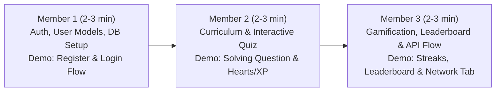

# 🚀 Team Project Division & Presentation Roadmap (Master Index)

## 👥 Team Setup: 3 Members
Yeh master guide project ko teen barabar hisson me divide karta hai taaki kisi par bhi extra burden na aaye. Har member ke pass uska dedicated **Presentation Script**, **Code Navigator**, aur **Teacher Viva Questions** hain.

---

## 📊 Summary of Equal Distribution

| Member | Assigned Domain | Frontend Pages | Backend Modules | Database Tables |
| :--- | :--- | :--- | :--- | :--- |
| **Member 1** | **User Authentication & Database Core** | `/login`, `/register`, `/profile`, `/settings` | `backend/app/modules/auth/`, `backend/app/modules/user/`, `backend/app/shared/database.py` | `users` |
| **Member 2** | **Core Learning Engine & Curriculum** | `/learn` (roadmap), `/lesson/[lessonId]` (quiz), `/vocabulary` | `backend/app/modules/course/`, `backend/app/modules/lesson/`, `backend/app/modules/progress/` | `courses`, `units`, `skills`, `lessons`, `questions`, `skill_progress` |
| **Member 3** | **Gamification, Social & API Architecture** | `/leaderboard`, `/friends`, Gamification widgets (`StreakDisplay`, `HeartDisplay`) | `backend/app/modules/gamification/`, `backend/app/modules/leaderboard/`, `frontend/lib/api-client.ts`, `backend/app/main.py` | `user_stats`, `leaderboard_entries`, `achievements` |

---

## 🎯 Presentation Speaking Order & Demo Flow (Total: ~8-10 Mins)

1. **Member 1 starts:**
   - Introduce project idea (Full Stack Duolingo Language Learning Platform).
   - Show User Registration & Login in browser (`http://localhost:3000/register`).
   - Open `backend/app/modules/user/models.py` and explain password hashing + JWT tokens.
2. **Member 2 takes over:**
   - Show the interactive Learning Path (`/learn`) and open a lesson (`/lesson/1`).
   - Answer a question live to show green banner / red banner and heart deduction.
   - Open `backend/app/modules/course/models.py` & `backend/app/modules/lesson/models.py` to explain Course -> Unit -> Skill -> Lesson -> Question relationships.
3. **Member 3 concludes:**
   - Show the Leaderboard (`/leaderboard`), Streak fire counter, and daily goals.
   - Open browser **Inspect -> Network Tab** and show live REST API communication with the backend.
   - Open `frontend/lib/api-client.ts` & `backend/app/modules/gamification/models.py` to explain Streak & XP logic.

---

## 📁 Individual Viva Guides (Read Your Own File!)
Har member ko bas apni file padhni hai:
- [MEMBER_1_AUTH_DATABASE_GUIDE.md](file:///c:/Users/aasth/Downloads/duolingo-web-App-clone-v1-main/MEMBER_1_AUTH_DATABASE_GUIDE.md)
- [MEMBER_2_LESSONS_CURRICULUM_GUIDE.md](file:///c:/Users/aasth/Downloads/duolingo-web-App-clone-v1-main/MEMBER_2_LESSONS_CURRICULUM_GUIDE.md)
- [MEMBER_3_GAMIFICATION_API_GUIDE.md](file:///c:/Users/aasth/Downloads/duolingo-web-App-clone-v1-main/MEMBER_3_GAMIFICATION_API_GUIDE.md)

